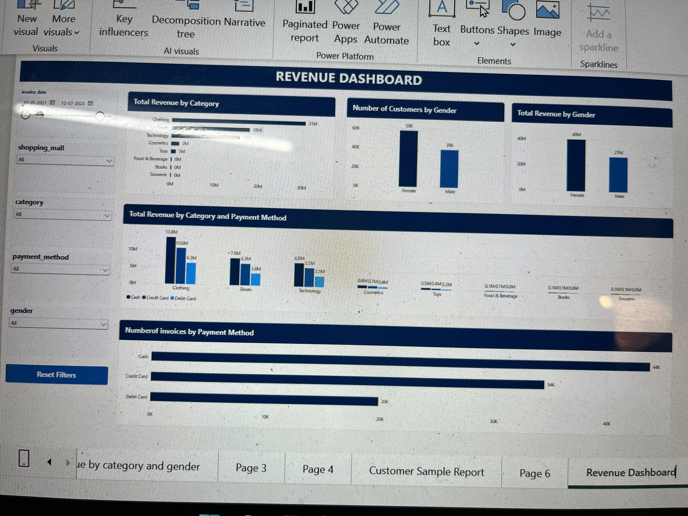
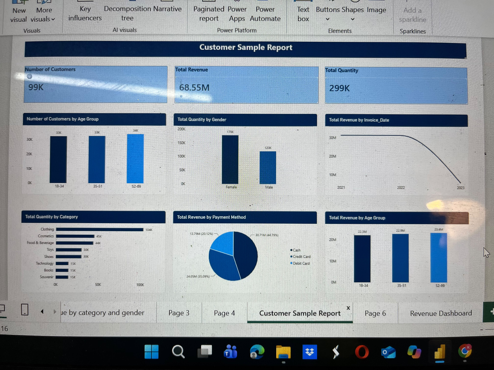

# Customer Data Analysis

## Project Overview
This project focuses on analyzing customer transaction data from multiple shopping malls  to understand customer purchasing behavior, revenue patterns, and product category performance.

## Objectives
- Analyze customer transactions based on gender and age.
- Understand product category performance.
- Evaluate payment method preferences.
- Identify revenue patterns and business insights.

## Tools & Technologies
- Power Query
- Microsoft Power BI 
- Microsoft Excel

## Analysis Performed
- Gender-wise customer analysis
- Age group segmentation
- Product category analysis
- Payment method analysis
- Revenue analysis

## Key Findings
- Female customers contributed a higher number of transactions.
- Clothing was among the major revenue-generating categories.
- Customer purchasing patterns varied across age groups.

## Skills Demonstrated
Data Analysis, Data Cleaning, Customer Segmentation, Data Visualization, Business Insights.

## Project Deliverables

- Customer and Revenue Dashboard Insights (PowerPoint Presentation)
- Customer and Revenue Dashboard Analysis Report (PDF)
- Dashboard Screenshots

## Dashboard Preview

### Dashboard 1

### Dashboard 2

